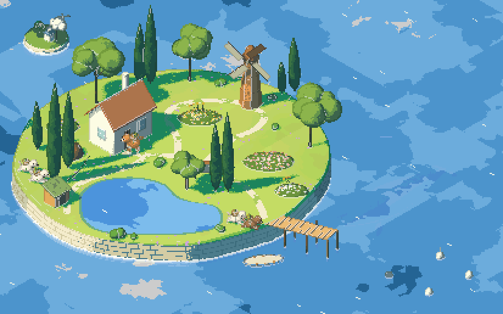
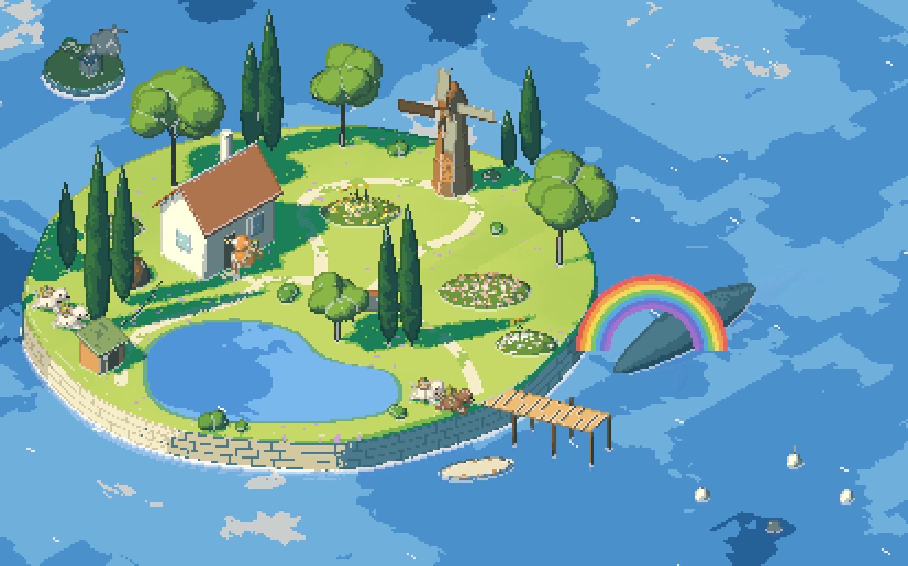
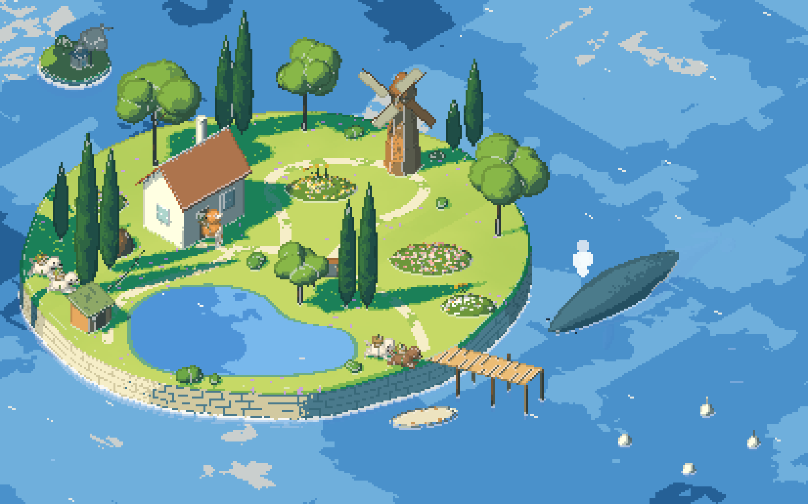

<p align="center"></p>

<h1 align="center">小狗工作台 · Puppy Workbench</h1>

<p align="center">
一个 DeepSeek Harness（DSH）插件：把 AI 在你电脑上做的每一步，画成一座像素小岛上的小狗故事。<br>
A DSH plugin that turns every real step your AI agent takes into a little pixel-art island where puppies act it out.
</p>

<p align="center"><a href="#中文">中文</a> · <a href="#english">English</a></p>

---

## 中文

### 这是什么

第一次用 AI Agent 的人常问：「它到底在我电脑上干什么？」日志看不懂，命令看不懂。

小狗工作台把**正在运行的真实会话**画成一座小岛：

| 画面里 | 实际上 |
|---|---|
| 小岛 | 你的电脑 |
| 一只小狗 | 一个 AI 会话；领队是你直接对话的 AI，帮手是它派出去的子 Agent |
| 海里的鲸鱼 | 大模型。每一步之前小狗都抬头问鲸鱼；鲸鱼冒的泡泡越多，大模型这次真实想得越久 |
| 花圃（木牌写文件夹名） | 闻花 = 读文件，种花 = 写文件 |
| 风车 | 跑终端命令；失败冒黑烟 |
| 岸边工具棚 | 接到 AI 上的本机软件（MCP，模型上下文协议） |
| 海那边的浮标和邮船 | 上网取网页 |
| 远处的小浮岛和海鸥 | 云端服务 |
| 小屋门口 | 你。需要你批准时，小狗抱着花坐在门口举牌「可以吗？」 |
| 鲸鱼喷出彩虹 | AI 给了你最终回答 |

小狗的反应跟着真实结果走：读到东西摇尾巴，失败了垂头甩脑袋，帮手交差时和领队碰碰鼻子。闲着的时候会闻闻地、挠耳朵、追蝴蝶——这些只是在玩，图鉴里写明了。

<p align="center"></p>

### 特点

- **全是真的**：每个动作都对应会话日志里一条真实记录，点开能看原始内容。唯一的推测是「连线」（东西从哪来、写到哪去），界面上标明了。
- **不会突然冒出来**：花从芽长出来，帮手从一团绒毛里长大，牌子翻面换字。
- **沉浸模式**：点「文字」把所有标注淡出，只留小狗的对话气泡和动画。
- **三维像素画**：Blender 建模、three.js 实时渲染，再画成像素画。不支持 WebGL 时退回平面版。
- **照顾「减少动态效果」**：系统开启时只用约 0.15 秒的淡入淡出。

### 安装

需要 DeepSeek Harness 桌面版。

**方法一：本地文件夹（已验证）**
1. 下载本仓库（Code → Download ZIP，或 Releases 里的 ZIP）并解压。
2. DSH →「插件」→「添加插件」，填入解压后文件夹的完整路径。
3. 重启 Harness，刷新界面。

**方法二：插件市场索引源**
DSH →「插件」→「发现」→「索引源」，添加：
```
https://raw.githubusercontent.com/hgognav233-netizen/dsh-puppy-workflow/main/index.json
```
然后在「发现」里搜「小狗工作台」安装。

装好后：对话输入框旁有「小狗」按钮（看当前会话），左栏有「小狗工作台」（看最近的会话）。

### 隐私

- 只**读**本机的会话日志：不写会话、不上传、不访问外网。
- three.js 和小岛模型都从插件自己的本地地址加载。
- 面板里会显示文件夹名、命令摘要、消息片段——截图分享前留意。

### 局限

- 本机软件和云端服务是按 MCP 服务器名字猜的，猜不中的云服务会画成岸边工具棚。
- 篮子里的枝叶是读进来的份数，不是真实的 token 用量（日志里没有这个数）。
- 花圃最多同时 4 块、工具棚 1 个、浮标 4 个，按最近使用轮换。
- 第一次打开要加载约 1.7 MB。

---

## English

### What it is

People new to AI agents keep asking: *what is it actually doing on my computer?* Logs and shell commands don't help.

Puppy Workbench draws the **live session** as an island:

| On screen | What it means |
|---|---|
| The island | Your computer |
| A puppy | An agent session — the lead is the AI you talk to, helpers are the sub-agents it sends out |
| The whale | The model. Before every step the puppy looks up and asks the whale; more bubbles = the model really took longer to think |
| Flower beds (signposts name the folders) | Sniffing = reading a file, planting = writing one |
| The windmill | Running a shell command; black smoke on failure |
| Shed on the shore | A local app plugged into the AI (MCP, the Model Context Protocol) |
| Buoys and the mail boat | Fetching web pages |
| The little islet and its gulls | Cloud services |
| The cottage door | You. When the AI needs your approval, a puppy sits at the door holding a flower and a sign: "May I?" |
| A rainbow from the whale | The AI gave you its final answer |

Reactions follow real results: a wag for a successful read, a hung head and a shake for a failure, a nose-boop when a helper hands its work back. Idle puppies sniff, scratch and chase butterflies — that's just play, and the picture guide says so.

<p align="center"></p>

### Highlights

- **Everything is real.** Each animation is one record in the session log; click it to see the raw entry. The only guess — the "flow" lines showing where things came from and went — is labelled as a guess.
- **Nothing pops.** Flowers grow from sprouts, helpers grow out of a puff of fluff, signs flip to change their words.
- **Immersive mode.** Toggle "Words" off to fade every label, leaving only the puppies' speech bubbles and the animation.
- **3D pixel art.** Modelled in Blender, rendered live with three.js, drawn as pixel art. Falls back to a flat 2D island without WebGL.
- **Respects reduced motion.** Only ~150 ms fades when the OS asks for less motion.

### Install

Requires the DeepSeek Harness desktop app.

**Option 1 — local folder (verified)**
1. Download this repository (Code → Download ZIP, or the ZIP under Releases) and unzip it.
2. DSH → Plugins → Add plugin, and enter the full path of the unzipped folder.
3. Restart the Harness and reload the window.

**Option 2 — market index source**
DSH → Plugins → Discover → Index sources, add:
```
https://raw.githubusercontent.com/hgognav233-netizen/dsh-puppy-workflow/main/index.json
```
then search for "Puppy workbench" in Discover.

Once installed: a "Puppy" button sits next to the chat input (current session), and "Puppy workbench" appears in the left sidebar (recent sessions).

### Privacy

- It only **reads** the local session logs: it writes nothing, uploads nothing, and makes no network requests.
- three.js and the island model load from the plugin's own local route.
- The panel shows folder names, command summaries and message snippets — mind that before sharing screenshots.

### Limits

- Local vs cloud MCP servers are guessed from the server name; unrecognised cloud services are drawn as a shed on the shore.
- The twigs in the basket count files read in, not real token usage (the log doesn't record that).
- At most 4 flower beds, 1 shed and 4 buoys at once, rotated by recent use.
- First open loads about 1.7 MB.

---

## Credits · 致谢

- [three.js](https://threejs.org) 0.184.0, MIT — `vendor/three/`, unmodified; source and checksums in `vendor/README.md`.
- Island modelled in Blender for this project.

## License

MIT — see [LICENSE](LICENSE).
